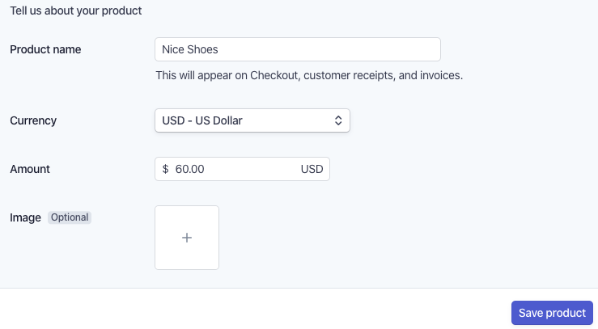

If you have been following me on Twitter, or even remotely know anything about me, it's that I'm incredibly invested in [https://stripe.com](https://stripe.com "Stripe") Checkout experience, especially in the JAMStack space.

Thanks to Checkout, I've been able to build out a Gatsby theme that allows you to launch an e-commerce store in a matter of minutes!

Unfortunately, because I'm trying to do all of this without the need of a server, there are some limitations. The idea is that a client of mine would simply need to be able to create their products on Stripe's dashboard, and their site would update accordingly. There are some things that are missing from the dashboard experience that would make Stripe even easier to leverage in the e-commerce space.

### 

### Product Descriptions

There is no way through the dashboard to create product descriptions

